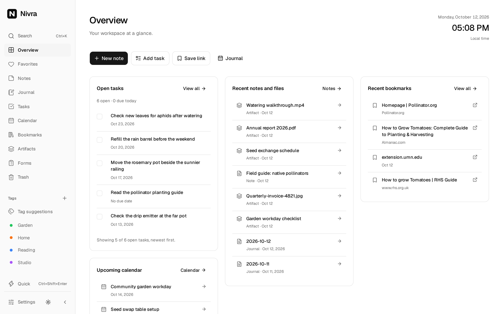

# Nivra

**Your thoughts, together.**

Nivra brings notes, journals, tasks, bookmarks and files into one quiet workspace. Plan with Calendar and Kanban, organize with smart tagging, find things with keyword or semantic search, and connect your agents through MCP.

<picture>
  <source media="(max-width: 600px) and (prefers-color-scheme: dark)" srcset="docs/images/overview-mobile-dark.webp">
  <source media="(max-width: 600px)" srcset="docs/images/overview-mobile.webp">
  <source media="(prefers-color-scheme: dark)" srcset="docs/images/overview-dark.webp">
  <source media="(prefers-color-scheme: light)" srcset="docs/images/overview.webp">
  
</picture>

- **Write and collect:** rich-text notes, drawings, attachments, bookmarks, tags, favourites and searchable artifacts with background OCR and thumbnails.
- **Plan:** daily journals, task dates, recurring tasks, Kanban boards, calendar events and push reminders.
- **Collect responses:** build and publish forms with text, choices, amounts and file uploads; review versioned responses, summaries and CSV/JSON exports.
- **Organize and find:** optional smart tagging uses your existing tags and examples you approve. Review suggestions by default, or opt into automatic tagging, where recurring topics can become reusable tags. Optional semantic search finds related content by meaning alongside keyword search, including extracted document and OCR text.
- **Connect:** MCP at `/mcp`, with API keys or OAuth, read-only or read/write access, and exact counts alongside paginated tools.
- **Keep it yours:** one owner, passkey or password login, optional TOTP, encryption at rest and encrypted backups. Use the browser or install the PWA. Editing requires a connection.

Smart tagging and semantic search are currently in preview on `main`.

See the [website](https://harsh-2002.github.io/Nivra/) for more workflows.

## Get started with Docker

The command below is for the updated image after release. Until then, use a [source build](CONTRIBUTING.md).

```sh
docker run -d --name nivra \
  --restart unless-stopped --init \
  -p 3000:3000 \
  -v nivra-data:/data \
  ghcr.io/harsh-2002/nivra:latest
```

Open **<http://localhost:3000>** and complete onboarding. The data volume holds the database, local files and generated keys. Docker selects AMD64 or ARM64 automatically.

For Compose, use [docker-compose.yaml](docker-compose.yaml) and run `docker compose up -d`.

For HTTPS behind a reverse proxy, add `-e NIVRA_PUBLIC_URL=https://notes.example.com` to `docker run`, or with Compose:

```sh
NIVRA_PUBLIC_URL=https://notes.example.com docker compose up -d
```

Change the host port with `-p 3001:3000`, or `NIVRA_PORT=3001` in Compose. Complete onboarding before exposing the installation, and save the recovery code. Passkeys and notifications require HTTPS or localhost.

Upgrade with `docker compose pull && docker compose up -d`. Back up first and keep the existing data volume. Releases use `vYYYY.MM.DD` with one active release and the Docker tag `latest`.

## Configuration

All three deployment settings are optional. Copy [.env.example](.env.example) to `.env` when needed.

| Variable                    | Default                          | Purpose                                       |
| --------------------------- | -------------------------------- | --------------------------------------------- |
| `NIVRA_PORT`                | `3000`                           | Host port published by Compose.               |
| `NIVRA_PUBLIC_URL`          | Address saved during setup       | Explicit public origin for a reverse proxy.   |
| `NIVRA_ENCRYPTION_KEY_FILE` | Generated key in the data volume | Mounted external key containing 32 raw bytes. |

Encryption defaults on and is chosen once during onboarding. **Settings → System** manages storage, upload limits, backups and smart features. S3 files and backups can share one connection and bucket. See [architecture and recovery](docs/architecture.md) for storage details.

The container runs as `nivra` (UID/GID 1000), listens on port 3000 and stores persistent data in `/data`. For a host directory:

```yaml
volumes:
  - /srv/nivra:/data
```

The directory must be writable by UID 1000. Mount an external encryption key read-only and set `NIVRA_ENCRYPTION_KEY_FILE` to its container path. Reverse proxies must preserve the host and serve Nivra at the domain root; subpath hosting is unsupported.

## Development

Nivra is built with Next.js, TypeScript, shadcn/ui, Tailwind CSS, BlockNote, SQLite/FTS5, Drizzle and Better Auth.

Requires **Node.js 24** and npm. From a cloned checkout:

```sh
ONNXRUNTIME_NODE_INSTALL=skip npm ci
npm run ai:assets # Prepare the pinned model for AI tests; Docker bundles it
npm run dev
```

Open <http://localhost:3000>. Install FFmpeg on the host for video thumbnails; Docker includes it. For hot reload behind a domain, set `NIVRA_PUBLIC_URL` and forward WebSocket upgrades through the proxy.

```sh
npm run typecheck
npm run lint
npm run format:check
npm run verify:branding
npm run verify:api
npm test
npm run build
```

See [CONTRIBUTING.md](CONTRIBUTING.md) for contribution guidance and API examples.

[Architecture and recovery](docs/architecture.md) · [MCP](docs/mcp.md) · [OpenAPI contract](docs/openapi.json) · [Testing](docs/testing.md)

MIT licensed. See [LICENSE](LICENSE) and [third-party notices](docs/third-party.md).
